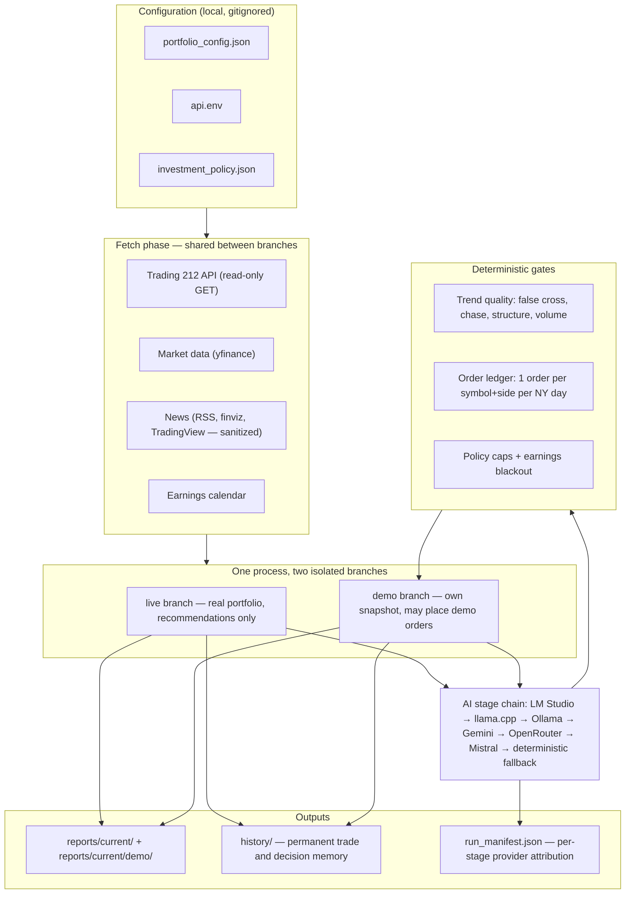

# Portfolio AI Assistant

A local-first portfolio monitoring and AI-assisted investment research tool for
personal accounts. Deterministic Python does every calculation; a local LLM
(LM Studio / Ollama, with optional cloud fallback) writes the interpretation.
Broker data comes from Trading 212 read-only endpoints. **Nothing in this
project places a live order** — the live branch is recommendations only; the
demo branch can execute against the demo account.

> **Disclaimer:** educational and personal research tool — no investment
> advice, no guaranteed returns, AI text can be wrong. Full text in the
> [Disclaimer](#disclaimer) section.

**What this is**

- a personal portfolio monitor: read-only broker sync, deterministic analysis,
  permanent history, AI-written briefs
- a research workbench: technicals, earnings calendar, news, broker statement
  reconciliation, advisory rotation and a demo execution sandbox

**What this is not**

- not a trading bot for live money (live execution is disabled by design)
- not a subscription signal service, and not investment advice
- not affiliated with Trading 212 or any data provider

## Features

- **T212 Integration** - Read-only portfolio sync via Trading 212 API
- **Live and demo branches in one run** - The live account produces
  recommendations (never an order) while the demo account gets its own snapshot,
  its own AI context and its own demo-only execution; market data and news are
  shared between the branches
- **Order ledger** - One order per symbol and side per New York trading day,
  checked against both the trade history and the audit DB before anything is
  sent; reruns cannot repeat an order with a different size
- **Technical Analysis** - RSI, MA crossovers, momentum, trend detection
- **Forecast Engine** - Scenario-based price projections (pessimistic/base/optimistic) over 1/5/20/60-day horizons
- **Signal Recording** - Every recommendation stored in SQLite for later backtesting
- **Day Trader Pack** - Vendored 11-skill day-trading toolkit with read-only premarket pack and demo execution layer
- **Multi-market universe** - S&P 500 + Nasdaq-100 + your portfolio + configurable EU/China/ETF symbols (EXI2.DE, VWCE.DE, etc.)
- **Permanent history** - `history/` stores every trade and AI decision (demo/live separated); cleanup never deletes it
- **Signal Generation** - BUY/SELL/HOLD with probabilities
- **Per-Asset News** - 48h filtered news with sentiment analysis
- **Local AI** - Works with Ollama or LM Studio (Fin-R1, Gemma, GPT-OSS)
- **Ticker self-healing** - Unresolvable holdings get Yahoo search-API suggestions
  (`failed_tickers.md` + console block with copy-paste `symbol_aliases` fix)
- **Deterministic Reports** - Markdown + JSON output
- **Advisory Rotation** - Portfolio rotation strategies (average-down, short-rotation,
  cash-apy) with simulated P&L and exit conditions; advisory only, no orders executed
- **CSV Toggle** - `--include-quantities` flag controls whether quantity columns
  are kept from CSV/XLSX input (default: tickers only)
- **PIE Exposure** - Detects standalone holdings outside PIEs (when portfolio quantity
  exceeds PIE quantity, the difference is a standalone holding)
- **Provider Load Guard** - Skips local LLM providers (LM Studio, llama.cpp, Ollama)
  when host is busy (GPU/CPU/RAM metrics) or model is not resident; falls back to
  cloud APIs automatically
- **Notifications** - Email (SMTP) + ntfy.sh push notifications (tiered: urgent/
  summary/debug) for run completion, failures, and debug alerts
- **Provider attribution** - Per-stage provider/model attribution in run manifest
- **Local model benchmark** - Ranks the installed local models on the real
  stages by speed, reliability and JSON/format compliance
  (see `tests/MODEL_BENCHMARK_README.md`); reports land on the Desktop and are
  never committed

## Quick Start

### 1. Install Dependencies (Python 3.12 required — use `py -3.12`)
```cmd
install.bat
```
This installs `requirements.txt` (pinned stack) **plus** the Playwright Chromium
browser (needed for the TradingView sweep, earnings layer 2 and the technicals
fallback). Equivalent manual steps:
```bash
py -3.12 -m pip install -r requirements.txt
py -3.12 -m playwright install chromium
```

### 2. Configure
```bash
cp api.env.example api.env
# Edit api.env with your T212 API credentials
```

### 3. Configure Portfolio

```bash
cp portfolio_config.example.json portfolio_config.json
cp investment_policy.example.json investment_policy.json
```

Then edit `portfolio_config.json` with your assets and `investment_policy.json`
with your limits. Both files are gitignored; only the `*.example.json`
templates are published. On Windows, use `copy` instead of `cp`.

`portfolio_config.json` is local by design: it may contain your watchlist,
broker symbols and model preferences. `PIEs/*.csv` exports are also gitignored
because they contain owned quantities and values; `PIEs/config/*.json` are
generic strategy examples.

### 4. Run (Python 3.12 required — use `py -3.12`)

**Full report (requires LM Studio unless all providers fall back to deterministic output):**
```bash
py -3.12 portfolio_ai_assistant.py
```

**Custom config:**
```bash
py -3.12 portfolio_ai_assistant.py --config portfolio_config.json
```

Supported flags today: `--config <path>`, `--investment-engine`, `--generate-full-report`
(compatibility only; reports are always written), `--execution-mode {auto,public,locals}`,
`--branches {both,live,demo}`, `--api-only`, `--preflight`, `--t212-csv <path>`,
`--include-quantities`, and `--rotation-plan {none,average-down,short-rotation,cash-apy}`.
Planned / not implemented: `--no-ai`, `--asset`, `--scheduled`, `--validate-only`, `--dry-run`.

### Live and demo branches

`--branches both` (the default) runs both accounts in one process:

| Branch | Portfolio data | AI context | Orders | Reports |
|---|---|---|---|---|
| `live` | live account, fetched by the run | own prompt + own provider instance | never — recommendations only | `reports/current/` |
| `demo` | demo account snapshot | own prompt + own provider instance | demo only, ledger-guarded | `reports/current/demo/` |

Shared between the branches: asset universe, market data and the news corpus
(both are cached per process, so the second branch does not fetch them again).
Isolated: portfolio snapshot, prompt, decisions, orders and report folder.

The live branch cannot place an order: live execution stays disabled by
`T212_LIVE_ORDER_ENABLED` and requires an explicit acknowledgement that is not
present in the configuration.

**Duplicate protection.** `investment_engine/order_ledger.py` allows one order
per symbol and side per New York trading day. It reads the trade history and the
day-trader audit DB, so a plan made before the open and rerun after it is
recognised as the same idea and blocked, even if the quantity changed. Failed and
blocked attempts do not count; a genuinely new day does.

**Local model selection.** `python tests/model_benchmark.py --run-all` measures
every installed model on decision/finance/fast/writer/thinking stages and writes
a ranked report (speed, reliability, format compliance) to the Desktop. Results
are machine-local and gitignored; each machine runs its own benchmark.


### Trading 212 statement reconciliation (optional)

Export the Activity CSV from Trading 212 and either:

1. Put it in `data/t212_exports/` (the newest `from_*.csv` is picked up automatically), or
2. Pass `--t212-csv "C:\\path\\to\\statement.csv"` for one run.

The decision brief, snapshot and intelligence brief gain a **Broker Statement Reconciliation**
section. It shows the raw statement deposits/withdrawals, the bridge to API net deposits
(cashback/card credits and deposit-fee gross-up), and the P&L bridge (realised P&L +
dividends + interest − explicit costs + unrealised P&L). Full data is in
`portfolio_analysis.json` under `t212_statement_reconciliation`.

The CSV is read-only, local and ignored by Git (`data/`). It never replaces broker/API
truth; it is an independent check. API `fees_eur` covers the deposit fee only; FX conversion,
stamp duty and FTT are embedded in trade totals and are shown separately by the statement.

Slovak-language news feeds are disabled by default for the English report. Set
`enable_slovak_news: true` in the config to ingest them.

**Environment verification (offline, no secrets printed):**
```bash
py -3.12 scripts/verify_environment.py
py -3.12 scripts/verify_environment.py --smoke
```

### Batch Files (Windows)
```cmd
run_automated.bat      # Daily automated run
run_full_report.bat    # Full report with AI
run_t212_analysis.bat  # T212 analysis only
```

## Configuration

### `portfolio_config.json`
- `assets` - Your portfolio assets with symbols, groups, aliases
- `settings` - Thresholds, AI backends, news settings
- `symbol_aliases` - T212 internal ticker → Yahoo Finance mappings
- `ai_backends` - LM Studio / Ollama model configuration

### `api.env`
```env
TRADING212_API_KEY=your_key
TRADING212_API_SECRET=your_secret
TRADING212_ENABLED=true
```

Real credentials, local endpoint addresses and model choices stay only in your
own `api.env` and `portfolio_config.json`; both are gitignored. The tracked
`api.env.example` uses placeholders only. Do not paste live keys into issues,
logs or commits.

Key reference (all optional unless noted; placeholders in `api.env.example`):

| Group | Keys |
|---|---|
| Broker | `TRADING212_API_KEY`, `TRADING212_API_SECRET`, `TRADING212_ACCOUNT_ID` |
| Execution safety | `T212_LIVE_ORDER_ENABLED`, `T212_LIVE_ACK` (never set in shipped configs) |
| Local AI | `LM_STUDIO_BASE_URL`, `LM_STUDIO_MODEL`, `LM_STUDIO_CONTEXT_TOKENS`, `LM_STUDIO_MAX_OUTPUT_TOKENS`, `LM_STUDIO_REASONING_EFFORT`, `OLLAMA_BASE_URL`, `OLLAMA_MODEL`, `MAX_CONCURRENT_MODELS` |
| Cloud fallback | `GEMINI_API_KEY`, `GEMINI_MODEL`, `OPENROUTER_API_KEY`, `OPENROUTER_MODEL`, `MISTRAL_API_KEY`, `MISTRAL_MODEL`, `OPENCODE_ZEN_API_KEY` |
| Mode | `PROVIDER`, `EXECUTION_MODE`, `LMSTUDIO_ENABLED`, `API_ONLY`, `LOAD_GUARD` |
| Run limits | `RUN_DEADLINE_SECONDS`, `RUN_WATCHDOG_SECONDS`, `CHAIN_BUDGET_SECONDS`, `PROVIDER_ATTEMPT_MAX_S` |
| Notifications | `NOTIFY_EMAIL*`, `NOTIFY_NTFY_TOPIC`, `NOTIFY_ON_FAIL`, `NOTIFY_ON_COMPLETE` |

### `investment_policy.json` and policy profiles

`investment_policy.json` holds caps, cash floor, earnings blackout, sizing and
averaging rules. `policy_profile` selects an optional preset that overrides the
matching fields; `custom` (the default) keeps the raw file values.

| Profile | Horizon | Adds to | Exits | Max position | Cash floor | Risk/trade |
|---|---|---|---|---|---|---|
| `passive` | 10+ years | core, long-term | manual only | 25% | 5% | 1.0% |
| `long_term` | 3-10 years | core, long-term | trims on core/long-term/thematic | 20% | 5% | 1.5% |
| `medium_term` | 1-3 years | + thematic | trims, all sleeves | 15% | 3% | 2.0% |
| `short_term` | days-months | thematic, tactical | full, never the core | 8% | 2% | 1.0% |
| `aggressive` | any | all sleeves | full, all sleeves | 30% | 0% | 3.0% |

```json
{ "policy_version": "v1", "policy_profile": "long_term", "...": "..." }
```

Rules that hold for every profile:

- A profile can **block or resize** a candidate; it can never create a trade.
  No committee decision means no plan, whatever the profile.
- Reconciliation `FAIL` and the earnings blackout still block BUY/ADD.
- Every override is listed in the report (`applied_overrides`), so a preset
  never silently changes a number.
- A preset only touches fields it defines; everything else stays as written.
- An unknown profile name marks the policy `INVALID` instead of guessing.

## Architecture



The pipeline itself is a sequence of small phases in
`investment_engine/run_phases/` (setup → broker → news → earnings →
enrichment → decisions → reporting); `run_engine.py` orchestrates, and the
CLI facade (`portfolio_ai_assistant.py`) is the only supported entry point.

### Where each number comes from (data provenance)

| Data class | Source | Where used | Trust level |
|---|---|---|---|
| Historical performance | Trading 212 Activity CSV, yfinance bars, `history/` DB | P&L bridge, backtesting, decision context | Broker statements and downloaded bars — verify against your broker |
| Current portfolio data | Trading 212 read-only API snapshot | Snapshot, weights, PIE exposure, demo sizing | Broker truth at fetch time |
| Calculated metrics | Deterministic Python (indicators, reconciliation, weights, FX, exposure) | Every brief and report | Reproducible: pinned pandas/numpy/scipy, covered by tests |
| AI-generated opinions | LLM stage outputs (summary, decision, recommendation text) | Narrative sections of the reports only | Advisory; may be wrong; the winning provider/model per stage is recorded in `run_manifest.json` |

Orders can never originate from an AI sentence: execution flows only through
the deterministic gates above, and the live branch has no order path at all.

### Supported data sources

| Source | Provides | Required? |
|---|---|---|
| Trading 212 REST API (GET only) | account, positions, PIEs, order history | for broker mode |
| yfinance | prices, fundamentals, FX, historical bars | yes |
| RSS feeds, finvizfinance, TradingView pages | 48h news, sentiment, scraped pages (sanitized) | optional |
| Trading 212 Activity CSV | statement reconciliation cross-check | optional |
| LM Studio / Ollama / cloud LLMs | interpretation text | local-first; cloud optional |
| `agent_data/` profiles | investor profile, tax facts, base rates | optional |

## Project Structure

```
portfolio_ai_assistant/
├── portfolio_ai_assistant.py   # Main entry point
├── portfolio_config.json       # Configuration
├── requirements.txt
├── api.env                     # Secrets (gitignored)
├── .gitignore
├── agent_data/                 # Investor operating data (examples tracked, real files local)
│   ├── investor_profile.example.yaml
│   ├── decision_log/           # Append-only decision records (gitignored)
│   ├── scratch/                # Working files, snapshots (gitignored)
│   └── charts/                 # Rendered chart pack (gitignored)
├── scripts/                    # verify_environment, ta_snapshot, fundamentals, decision_log
├── trading212/                 # T212 modules
│   ├── auth.py                 # Authentication
│   ├── portfolio.py            # Portfolio analysis
│   └── integration.py          # High-level integration
├── investment_engine/          # Core engine
│   ├── config/                 # Settings, policy profiles
│   ├── branches.py             # Live + demo branches (own snapshot, own AI)
│   ├── order_ledger.py         # One order per symbol+side per trading day
│   ├── notifications.py        # Email + ntfy.sh notification dispatch
│   ├── run_engine.py           # Run orchestrator (thin: calls run_phases)
│   ├── run_phases/             # One module per pipeline stage
│   │   ├── setup.py            # Run identity, watchdog, asset universe
│   │   ├── broker.py           # T212 fetch + canonical reconciliation
│   │   ├── news.py             # News fetch + source ledger
│   │   ├── earnings.py         # Earnings fast path + calendar layer
│   │   ├── enrichment.py       # Per-holding research + PIE deep dive
│   │   ├── decisions.py        # Per-scope LLM decision sections
│   │   ├── ai_context.py       # Machine context archive
│   │   └── reporting.py        # Briefs, diagnostics, result payload
│   ├── fetching.py             # T212/news/earnings/technicals fetchers
│   ├── run_state.py            # Per-run fallback + attribution state
│   ├── portfolio/              # PIE exposure, symbols, broker-first
│   │   ├── t212_view.py        # Snapshot accessors (one precedence rule)
│   │   ├── pie_exposure.py     # Standalone holdings detection
│   │   └── ...
│   ├── providers/              # LLM providers (LM Studio, Ollama, Gemini, etc.)
│   │   ├── generation.py       # Routing, chained generation, fallback
│   │   ├── telemetry.py        # Local-AI attempt tracker
│   │   ├── health.py           # Load-guard busy detection
│   │   └── ...
│   ├── reporting/              # Brief/snapshot/deep-dive builders
│   │   ├── sections.py         # Formatting helpers extracted from main.py
│   │   └── ...
│   ├── rotation.py             # Advisory rotation strategies
│   └── ...
├── experimental/               # Isolated backtest sandbox (not production)
│   └── README.md               # Sandbox status and rules
├── examples/                   # Anonymized example outputs
│   └── github/                 # Example reports, PIE CSVs, README
├── tests/                      # Unit tests
│   ├── model_benchmark.py      # Local model benchmark (results: Desktop, gitignored)
│   ├── test_branches.py        # Live/demo branch isolation
│   ├── test_order_ledger.py    # Duplicate-order protection
│   ├── test_rotation.py        # Rotation tests
│   └── test_load_guard.py      # Load-guard tests
├── reports/                    # Generated reports (gitignored)
├── logs/                       # Runtime logs (gitignored)
├── data/                       # Cache/data
└── run_*.bat                   # Windows batch helpers
```

### Package roles and boundaries

- `portfolio_ai_assistant.py` is the only supported CLI facade. It parses
  arguments, sets up logging, calls `investment_engine.main.run_engine`, and
  publishes reports.
- `investment_engine/` is the production domain engine: settings, portfolio
  canonicalization (`broker_first`), research, providers, accounting, and
  reporting.
- `trading212/` is the production broker adapter. The root
  `trading212_*.py` files are compatibility shims; do not add new code there.
- `experimental/` is an isolated backtest sandbox with its own tests. Production
  packages must never import it.
- `scripts/` contains offline verification and operator tooling, not runtime
  pipeline code.

## Agent tooling (TA snapshots, charts, fundamentals, decision log)

```cmd
py -3.12 scripts/ta_snapshot.py --symbol AAPL --exchange NASDAQ --currency USD --benchmark SPY
py -3.12 scripts/ta_snapshot.py --symbol AAPL --charts agent_data/charts
py -3.12 scripts/fundamentals.py --symbol AAPL
py -3.12 scripts/decision_log.py new --ticker AAPL --mode M1 --verdict HOLD --confidence medium
py -3.12 scripts/verify_environment.py   :: preflight incl. matplotlib + pip-check gate
```

- `ta_snapshot.py` writes an Appendix-B7 JSON (`agent_data/scratch/`, gitignored):
  exact Wilder/SMA/EMA/Bollinger math, B3 regimes, zones, drawdowns, percentiles.
- `--charts` renders C1–C5 PNGs (12×7", 150 dpi, colorblind-safe) into `agent_data/charts/`.
- `fundamentals.py` builds the §5.2 pack (TTM, margins, FCF, ROIC, growth) from
  yfinance statements; gaps are null with notes, never invented.
- Copy `agent_data/*.example.*` to the real names and fill them in; without a
  profile, suitability conclusions are provisional.

## Security model

- **Broker access has three layers** (see `docs/security.md`):
  1. Read-only analysis (`trading212/` package): `Trading212Auth.make_request`
     refuses every non-GET call at code level.
  2. Demo order execution (`investment_engine/day_trader/broker/t212_orders.py`):
     POST/DELETE on a demo client, gated by `guard.evaluate`, the order ledger
     and a kill switch.
  3. Live-capable low-level client (same module, `environment="live"`):
     writes blocked unless `T212_LIVE_ORDER_ENABLED=1` and
     `T212_LIVE_ACK=I_UNDERSTAND_LIVE_TRADING`. Disabled by default; no
     shipped configuration enables it.
- **Outbound traffic is GET-only market data** (yfinance, RSS, TradingView
  pages) plus the configured local/cloud LLM endpoints. Queries carry public
  identifiers only (ticker, company, topic) — never positions, values,
  account ids or keys.
- **Secrets live in `api.env`** (gitignored) and `agent_data/*.yaml`
  (gitignored). Tracked are only `*.example.*` placeholders and `.gitkeep`.
- **Scraped news is sanitized** before use: prompt-injection shapes are
  quarantined (hash retained, text dropped), query strings stripped.
- **Permanent memory:** `history/` keeps buys, sells and AI decisions with
  reasons. `cleanup.bat` and `purge_outputs.bat` only touch `reports/` and
  `logs/`, never `history/`.
- **Mode separation:** logs go to `logs/live/` or `logs/demo/`; day-trader
  reports go to `reports/day_trader/live/` or `reports/day_trader/demo/`.

## LM Studio setup and local model configuration

1. Install [LM Studio](https://lmstudio.ai), load one small model, and start
   the local server (`Developer` tab → `http://127.0.0.1:1234/v1`). No API key
   is needed locally.
2. Point the engine at it in `api.env`:
   `LM_STUDIO_BASE_URL=http://127.0.0.1:1234/v1` and
   `LM_STUDIO_MODEL=<model-id>`.
3. `MAX_CONCURRENT_MODELS=1` keeps loading exclusive: when the chain moves to
   another model, the previous one is evicted instead of stacking VRAM.
4. Prompt sizing is conservative (`chars/2` heuristic) and controlled by
   `LM_STUDIO_CONTEXT_TOKENS` / `LM_STUDIO_MAX_OUTPUT_TOKENS`;
   `LM_STUDIO_REASONING_EFFORT=none` disables thinking tokens. A
   "context size has been exceeded" 400 is parsed for the real token count and
   retried smaller instead of hanging.

### Per-stage routing (`portfolio_config.json` → `ai_backends`)

| Stage | Config key | Typical pick |
|-------|------------|--------------|
| `summary` | `writer_model` | small instruct model (clear prose) |
| `discovery` | `thinking_model` | reasoning model, wide context |
| `decision`, `ai_recommendations` | `finance_model` | reasoning + math strength |
| everything else | `decision_model` | chain default |

Run the benchmark on your own machine before trusting any example name:
`python tests/model_benchmark.py --run-all` ranks every installed model per
stage on speed, reliability and JSON/format compliance. Results land on the
Desktop and stay gitignored — each machine runs its own benchmark. Dense
models 27B+ are opt-in (`--include-large`), deliberately: they are slow on
consumer hardware and add nothing the stage needs.

Benchmark result on the author's machine (2026-11): a small sparse MoE
(`nvidia-nemotron-3.5-bolt-e4b`) reached ~45–51 tok/s with 5/5 format
compliance and beat a 9B dense model (~5 tok/s, broken JSON) — decisively.

Chain: LM Studio → llama.cpp (Pi) → Ollama (Pi) → Gemini → OpenRouter `:free` →
Mistral → deterministic fallback. The real winner per stage is recorded in
`run_manifest.json` (`providers_per_stage`). Configure in the `ai_backends`
section of `portfolio_config.json`.

## Financial calculations

All numeric outputs are deterministic Python — the same inputs always produce
the same numbers:

- **Technical indicators** — SMA/EMA/MACD/RSI (Wilder), Bollinger, ATR, ADX,
  Supertrend, OBV, rolling VWAP; the manual engine is canonical (details in
  [Technical indicators](#technical-indicators-optional-dependencies)).
- **Broker statement reconciliation** — deposits/withdrawals bridge to API net
  deposits, and the P&L bridge: realised P&L + dividends + interest − explicit
  costs + unrealised P&L (see the [reconciliation section](#trading-212-statement-reconciliation-optional)).
- **PIE exposure** — standalone holdings = portfolio quantity − PIE quantity,
  reported per asset.
- **Allocation and weights** — per-asset weight and group caps from the
  selected policy profile.
- **Rotation simulation** — trim/reinvest strategies with simulated APY
  (advisory only; see [Rotation strategies](#rotation-strategies-advisory-only)).

Pinned stack: `pandas==2.2.3`, `numpy==1.26.4`, `scipy==1.13.1` — see the note
in Technical indicators for why.

## Risk management

Deterministic, layered, and no single gate decides a trade:

1. **Trade-safety gates** (`investment_engine/research/trend_quality.py`,
   wired into `apply_trade_safety`) — a BUY is withheld (downgraded to HOLD
   with a stated reason) when:
   - **false golden cross** — the 20-day MA crossed above the 50-day MA while
     the 50-day MA is still declining, or the pair whipsawed repeatedly in the
     lookback window;
   - **chase risk** — the price is extended far above its 20-day MA after a
     near-vertical run (buying tops is not a plan);
   - **distribution** — lower highs with a broken support level;
   - **volume-less squeeze breakout** — price closed above a compressed MA
     range without the volume to confirm it. Missing data never blocks a
     decision.
2. **Policy profiles** (`investment_policy.json`) — cap position size, keep a
   cash floor, and block BUY during the earnings blackout and after a
   reconciliation FAIL (table above). A profile can block or resize a
   candidate; it can never create a trade.
3. **Order ledger** (`investment_engine/order_ledger.py`, demo execution only)
   — one order per symbol and side per New York trading day, checked against
   both the trade history and the audit DB; reruns cannot repeat an order even
   with a different size.
4. **Live execution kill switch** — the live branch never orders. Code-level
   guards require `T212_LIVE_ORDER_ENABLED=1` **and** an explicit
   acknowledgement (`T212_LIVE_ACK`); no shipped configuration sets either.
5. **Concentration checks** — per-asset weight cap and standalone-vs-PIE
   exposure in the snapshot.

## Scheduled operation

Windows Task Scheduler (or double-click `run_full_report.bat`, which pins Python 3.12):

```cmd
py -3.12 portfolio_ai_assistant.py --config portfolio_config.json --investment-engine --generate-full-report
```

With rotation and CSV toggle:
```cmd
py -3.12 portfolio_ai_assistant.py --config portfolio_config.json --investment-engine --generate-full-report --rotation-plan average-down --include-quantities
```

> Note: `--scheduled` is planned / not implemented. The batch files above pass only
> the actually supported flags. A `runtime/run.lock` single-run lock plus exit codes
> `3` (already running) / `4` (partial) / `5` (broker sync failed) are likewise
> planned / not implemented.

Current outputs per run (see `portfolio_ai_assistant.write_reports`):

```text
reports/current/portfolio_intelligence_brief.md  # short human brief (≤60 lines, read this)
reports/current/portfolio_decision_brief.md      # curated deterministic brief
reports/current/t212_portfolio_snapshot.md       # full broker inventory
reports/current/portfolio_analysis.json          # canonical machine-readable result
reports/current/failed_tickers.md                # only when tickers are unresolvable
reports/current/rotation_plan.md                 # advisory rotation plan (when --rotation-plan is non-none)
reports/current/run_manifest.json                # run_id, sha256, counts, recon, providers, indicator engine
reports/ai_context/ai_context_<run_id>.md        # full machine archive
reports/debug/<run_id>/                          # raw dump, recon diagnostics, run log
reports/archive/<run_id>/                        # full copy of current/ for this run
```

Provider policy: local-first chain, **LM Studio is the default primary**
(LM Studio → llama.cpp on Pi → Ollama on Pi → Gemini → OpenRouter `:free`
→ Mistral → deterministic fallback). Disable locals with
`--execution-mode public` / `API_ONLY=1`, or LM Studio alone with
`LMSTUDIO_ENABLED=0`. Every run records the actual winning provider/model
per stage in `run_manifest.json` (`providers_per_stage`); `provider` is the
winners summary, `stance` the human portfolio stance.

Exit codes today: `0` success · `1` report/LLM-stage failure · `2` config error
(unknown flags also exit `2` via argparse).

Pre-flight checks (offline, no secrets printed):

```cmd
py -3.12 scripts/verify_environment.py          :: interpreter, deps, gitignore, syntax
py -3.12 scripts/verify_environment.py --smoke  :: plus one fast offline test module
py -3.12 -m pytest tests/ -q                    :: full offline unit suite
py -3.12 -m pytest experimental/tests/ -q       :: isolated backtest suite
```

## Technical indicators (optional dependencies)

`pandas-ta` is optional and NOT required. When installed, `TechnicalAnalyzer` uses the
`pandas-ta` engine; otherwise it falls back to deterministic manual indicators
(SMA/EMA/MACD/RSI/Bollinger/ATR/simplified ADX and Supertrend, OBV, rolling VWAP, …).
Both paths are covered by tests, but numerics differ — see the tracked
`docs/archive/audit/PROJECT_AUDIT.md` (Technical Indicator Audit) and run
`scripts/verify_environment.py` to see which engine would activate on your PC. `tzdata` is a core requirement so `ZoneInfo` works on Windows.
Pinned stack (reproducible installs): `pandas==2.2.3`, `numpy==1.26.4`,
`scipy==1.13.1` — pandas 3.x is not supported (breaks frozen manual-v1 numerics).

Secrets: `api.env` holds real keys — never commit it, never paste logs containing
`Authorization`/`Bearer`/`key=` values (the tool redacts them automatically).

## Output (legacy layout note)

- `reports/portfolio_analysis.md` - Human-readable Markdown (compat copy of the main report)
- `reports/portfolio_analysis.json` - Machine-readable JSON (compat copy)
- `reports/archive/` - Timestamped history (new layout: `YYYY-MM-DD/<run_id>/`)
- `reports/latest/` - Always the newest complete run (published atomically)

## Notifications (optional)

The engine can send notifications after a run:

- **Email** (SMTP) — daily/weekly report summary
- **ntfy.sh** — push notifications to mobile (iOS/Android)

Configure in `api.env`:
```env
NOTIFY_EMAIL=your@gmail.com
NOTIFY_EMAIL_PASSWORD=your_app_password
NOTIFY_EMAIL_TO=recipient@example.com
NOTIFY_NTFY_TOPIC=portfolio-alerts
NOTIFY_ON_FAIL=1
NOTIFY_ON_COMPLETE=1
```

- `NOTIFY_ON_FAIL=1` — sends urgent email + ntfy on run failure/PARTIAL
- `NOTIFY_ON_COMPLETE=1` — sends summary email on successful run
- If not configured, notifications are silently skipped (no errors)

## Rotation Strategies (advisory only)

The engine supports advisory rotation strategies via `--rotation-plan`:

| Strategy | Description |
|---|---|
| `average-down` | Reduce losing positions by `trim_pct` (default 30%), reinvest at same ticker |
| `short-rotation` | Reduce losing positions, rotate released capital to target ticker |
| `cash-apy` | Full reduction to cash, earn simulated APY, repurchase when accumulated |

```cmd
py -3.12 portfolio_ai_assistant.py --config portfolio_config.json --investment-engine --generate-full-report --rotation-plan average-down --include-quantities
```

Output: `reports/current/rotation_plan.md` (advisory, no orders executed).

## Load Guard (provider busy detection)

Local LLM providers (LM Studio, llama.cpp, Ollama) are automatically skipped when:
- Host is unreachable (connect refused) → 300s cooldown
- Host is busy (GPU/CPU/RAM metrics exceed thresholds) → 120s cooldown
- Model is not resident (Ollama `/api/ps`) → 120s cooldown
- Generation attempt times out → 300s cooldown

Falls back to cloud APIs (Gemini → OpenRouter → Mistral) automatically.

Kill switch: `LOAD_GUARD=0` in `api.env` disables all guard checks.

## Roadmap

Planned, not implemented yet (the flags are documented today, argparse rejects
them until they exist):

- `--scheduled` Task Scheduler mode with a `runtime/run.lock` single-run lock
  and exit codes `3` (already running), `4` (partial), `5` (broker sync failed)
- `--no-ai`, `--asset`, `--validate-only`, `--dry-run` flags
- an optional, anonymized way to share benchmark results between machines
  (results themselves stay local and gitignored)
- continued docs polish as the project grows

No timeline promises — development happens between market hours and life.
Nothing on this roadmap is an investment feature or a returns claim.

## Limitations

- **AI output is advisory interpretation, not advice.** It can be confidently
  wrong; the deterministic pipeline and your own judgment are the controls.
- **No guaranteed returns.** Nothing here predicts markets; every metric
  describes the past.
- **No live order execution.** Demo orders only, ledger-gated; the live
  account is read-only by design.
- **Single-user, local application.** No accounts, no server, no multi-user.
- **Python 3.12 only** (developed on Windows; use `py -3.12`). pandas 3.x is
  unsupported (breaks frozen numerics); `pandas-ta` is optional and its
  numerics differ from the manual engine.
- **Free data sources.** News coverage, fundamentals and prices come from free
  feeds; gaps are reported as `null` with notes, never invented values.
- **Cloud fallbacks see ticker-level queries only** — never positions, values,
  account ids or keys. LM Studio keeps everything on your machine.
- **The Trading 212 statement CSV is a cross-check**, never truth; the API
  snapshot is broker truth at fetch time.
- **Benchmark results are machine-specific** — rerun on your hardware before
  choosing models.

## Disclaimer

- This project is an **educational and personal research tool**. It is **not
  investment advice**, not a recommendation to buy or sell anything, and not a
  tax or accounting service.
- **No guarantee of returns.** Markets involve risk, including loss of
  principal. The author and contributors are not liable for any decisions or
  losses made using this software.
- **AI-generated sections are opinions produced by language models** from the
  data given to them; they may be incomplete, outdated or simply wrong.
- **Not affiliated with Trading 212** or any broker or data provider. Broker
  credentials stay in your local `api.env` and are used only against the
  official read-only API.
- Verify every number independently before acting on it, and consider a
  licensed financial advisor for decisions about your money.

## Examples

Anonymized example outputs are in `examples/github/`:
- `portfolio_snapshot.md` — broker account summary + holdings
- `portfolio_decision_brief.md` — curated deterministic brief
- `rotation_plan_*.md` — rotation plan examples (3 strategies)
- `PIEs/*.csv` — example PIE CSV exports
- `README.md` — explanation of example outputs

Illustrative shape of the analysis — **synthetic numbers, not real portfolio
data**:

```text
AAPL   weight 12.4%   P&L +8.2%    RSI 56   trend: uptrend    stance: HOLD   (chase risk: LOW)
MSFT   weight  6.1%   P&L −3.4%    RSI 41   trend: sideways   stance: WATCH  (catalyst: EVENT_DRIVEN)
```

Every row above is deterministic output; the AI adds only the narrative around
it — and which provider/model wrote that narrative is recorded per stage in
`run_manifest.json`.

## License

MIT

---

## Sponsorship

The engine, its test suite and its documentation are built and maintained in
spare time. If the project saves you time or teaches you something, sponsoring
keeps it moving:

[](https://github.com/sponsors/DracieVajko)

Support contributes to:

- financial data infrastructure (API reliability, feed quality checks)
- improved calculations and portfolio analytics
- local AI integration (provider chain, load guard, model benchmarking)
- testing and documentation
- general open-source maintenance (issues, reviews, releases)

| Tier | Amount | Benefit |
|------|--------|---------|
| Supporter | $2 | supports ongoing development |
| Backer | $5 | name listed in this README's supporters list |
| Sponsor | $10 | vote in roadmap priority polls (GitHub Discussions) |
| Gold Sponsor | $25 | the above + early look at release notes |

Benefits are community and development perks only — never investment
recommendations, portfolio reviews or private financial advice. The
[`.github/FUNDING.yml`](.github/FUNDING.yml) file enables the Sponsor button
on this repository (GitHub Sponsors, approved 2026-11).

Supporters so far: *(none listed yet — your name could be first)*
